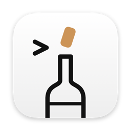
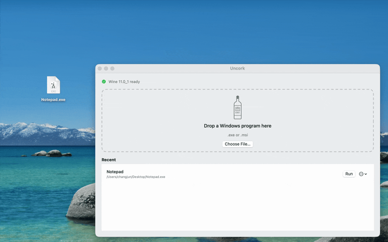

<p align="center">
  
</p>

# Uncork

Run Windows programs on your Mac by dropping them on a window.

Uncork is a small native macOS app on top of [Wine](https://www.winehq.org). It takes care of the parts that make Wine
hard to use on a Mac: installing it, keeping programs separate, and finding out what went wrong.

<p align="center">
  
</p>

- **Drop and run.** Drop a `.exe` or `.msi` on the window or the Dock icon, or use *Open With → Uncork* in Finder.
- **No setup.** The first time you open a program, Uncork downloads a Wine runtime (about 185 MB), checks its SHA-256,
  and unpacks it. Nothing else to install.
- **One prefix per program.** Every program gets its own Wine prefix, so one program can't break another.
- **Logs one click away.** Wine's output for each program is saved, and *Show Log* opens it.
- **Cleans up after itself.** Quitting Uncork stops the Wine background processes its programs leave behind.

> Uncork isn't affiliated with the Wine project or CodeWeavers. It's early software (0.1): expect rough edges.

## Why Uncork

Running a Windows program on a Mac got harder in 2026:

- Homebrew [disabled](https://github.com/Homebrew/homebrew-cask/blob/main/Casks/w/wine-stable.rb) the `wine-stable` cask on 2026-09-01 because its
  builds don't pass the macOS Gatekeeper check, so `brew install --cask wine-stable` now fails.
- [Whisky](https://github.com/Whisky-App/Whisky), the popular open-source Wine app for macOS, is
  [no longer maintained](https://docs.getwhisky.app/maintenance-notice) and its repository is archived.

Uncork fills that gap for the simple case: you have one `.exe` and want to run it. It's installed from source with
Homebrew, so Gatekeeper doesn't get in the way, and it fetches and verifies a current Wine build for you.

## What runs, and what doesn't

Uncork runs programs with Wine, so it can run what Wine can run. Before you rely on a program, look it up in the
[Wine Application Database](https://appdb.winehq.org).

- **Usually fine:** small utilities, installers, older desktop apps and many older games.
- **Often not:** games with anti-cheat, anything that installs drivers or kernel components, many DirectX 12 games, and
  apps that need online Microsoft or DRM services.

If a program fails, *Show Log* in the program's menu opens Wine's output, which usually says why.

### Compared with other options

| | Uncork | [CrossOver](https://www.codeweavers.com/crossover) | Whisky | Windows in a VM (Parallels, UTM) |
|---|---|---|---|---|
| Price | Free, MIT | Paid | Free | Paid or free, plus a Windows licence |
| Maintained | Yes | Yes, with support | No | Yes |
| Compatibility | Wine | Wine plus CodeWeavers' fixes | Wine | Full Windows |
| Setup | Drop a file | App with bottles | App with bottles | Install Windows |

## Requirements

- macOS 14 or later
- On Apple Silicon: Rosetta 2. Uncork offers to install it, or run
  `softwareupdate --install-rosetta --agree-to-license`.

## How to install

### Homebrew

```sh
brew install 61uehigh/tap/uncork
```

Or add the tap once, then use the short name:

```sh
brew tap 61uehigh/tap
brew install uncork
```

Homebrew builds Uncork from source on your Mac, which takes a minute or two and needs Xcode's Command Line Tools
(`xcode-select --install`). Because it's built locally, Gatekeeper doesn't block it.

Then open the app:

```sh
open "$(brew --prefix)/opt/uncork/Uncork.app"
```

To find it in Launchpad and Spotlight, link it into Applications:

```sh
ln -sf "$(brew --prefix)/opt/uncork/Uncork.app" /Applications/Uncork.app
```

The formula also installs an `uncork` command that opens a program in the app:

```sh
uncork path/to/program.exe
```

Update with `brew upgrade uncork`.

### From source

See [Build from source](#build-from-source).

## Build from source

You only need Xcode's Command Line Tools; full Xcode isn't required.

```sh
./scripts/bundle.sh       # builds build/Uncork.app
open build/Uncork.app
```

Regenerate the app icon after editing `scripts/icon/AppIcon.swift`:

```sh
./scripts/make-icon.sh    # writes Resources/AppIcon.icns and docs/icon.png
```

Run the tests:

```sh
./scripts/test.sh
```

You can also open a program from the command line:

```sh
build/Uncork.app/Contents/MacOS/Uncork path/to/program.exe
```

## Releasing

1. Tag the release and push the tag: `git tag -a v0.2.0 -m "Uncork 0.2.0" && git push origin v0.2.0`
2. Publish a GitHub release for the tag: `gh release create v0.2.0`

[61uehigh/homebrew-tap](https://github.com/61uehigh/homebrew-tap) checks for a new release every six hours and points
its formula at the release's source and checksum. To pick up a release straight away, run its *Update uncork* workflow
by hand. Pre-releases are skipped.

## How it works

| Part | What it does |
|---|---|
| `WineReleaseCatalog` | Picks the newest `wine-stable` build from [Gcenx/macOS_Wine_builds](https://github.com/Gcenx/macOS_Wine_builds), falling back to `wine-devel`. These are the builds Homebrew's `wine-stable` cask used to install. |
| `RuntimeManager` | Downloads the build, checks it against the SHA-256 that GitHub publishes, and unpacks it to `~/Library/Application Support/Uncork/Runtime`. |
| `PrefixManager` | Creates one prefix per program path under `…/Uncork/Prefixes`. |
| `Launcher` | Runs `wine` with that program's `WINEPREFIX`, in the program's folder, and writes its output to `…/Uncork/Logs`. |
| `Rosetta` | Checks for Rosetta 2 and installs it. |

### About Gatekeeper

The Wine builds Uncork downloads aren't signed or notarized by Apple, and that's why Homebrew disabled its `wine-stable`
cask. Uncork downloads the build itself and checks its SHA-256 before using it, so you're trusting the Gcenx builds the
same way you would by installing them yourself.

## Uninstall

If you installed with Homebrew, run `brew uninstall uncork` and remove the `/Applications/Uncork.app` link if you made
one. If you built it yourself, delete `Uncork.app`.

Either way, delete `~/Library/Application Support/Uncork` to remove the Wine runtime, your programs' prefixes and logs.

## License

MIT. Wine is licensed under the LGPL. Uncork doesn't bundle Wine: it downloads Wine at first run and runs it as a
separate process.
